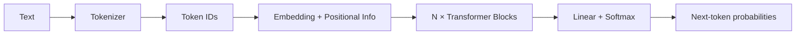
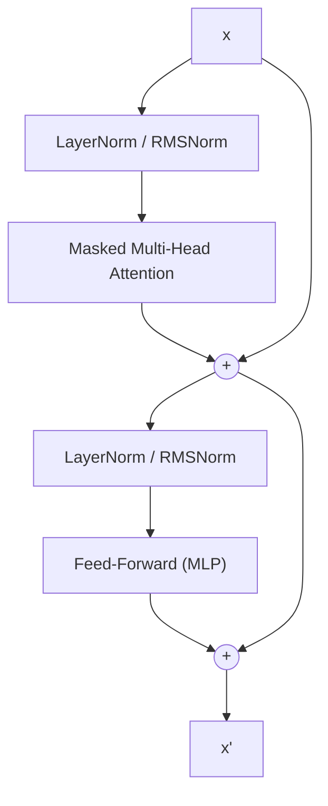
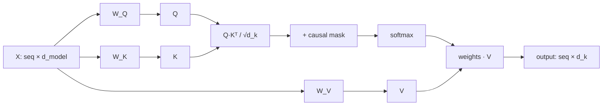
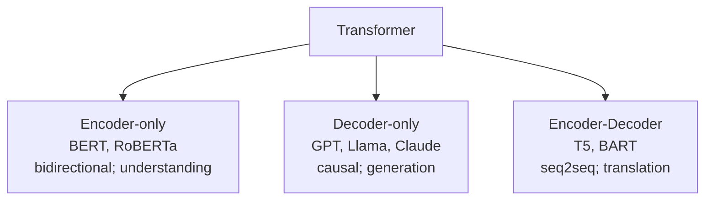

# Transformer Architecture Overview

Introduced in *Attention Is All You Need* (Vaswani et al., 2017). Replaces recurrence with **self-attention**, so all tokens are processed in parallel and any token can attend directly to any other.

## 1. Big Picture




## 2. Original Encoder–Decoder Layout

```
        ENCODER (N×)                         DECODER (N×)
   ┌─────────────────────┐             ┌─────────────────────────┐
   │  Feed Forward       │             │  Feed Forward           │
   │  Add & Norm         │             │  Add & Norm             │
   │  Multi-Head Self-   │──── K,V ───▶│  Cross-Attention        │
   │  Attention          │             │  Add & Norm             │
   │  Add & Norm         │             │  Masked Multi-Head      │
   └─────────▲───────────┘             │  Self-Attention         │
             │                         └────────────▲────────────┘
   Input Embedding + PosEnc            Output Embedding + PosEnc
             ▲                                      ▲
         Source tokens                    Target tokens (shifted right)
                                                    │
                                          Linear → Softmax → probs
```


## 3. One Transformer Block (modern pre-norm, decoder-only)




The `+` edges are **residual connections**; they keep gradients flowing through deep stacks.

## 4. Self-Attention

Each token embedding is projected into a **query** (Q), **key** (K), and **value** (V):

```
Attention(Q, K, V) = softmax( Q Kᵀ / sqrt(d_k) ) V
```




Attention weights for the sentence "the cat sat" (causal mask: no peeking ahead; `·` = masked):

```
            attends to →
             the   cat   sat
   the   [  1.00   ·     ·   ]
   cat   [  0.30  0.70   ·   ]
   sat   [  0.10  0.55  0.35 ]
```

- `√d_k` scaling keeps dot products from saturating softmax.
- **Causal mask** (decoder) sets future positions to `-inf` before softmax.


## 5. Multi-Head Attention

Run `h` attention heads in parallel on lower-dim projections, concatenate, then mix.

```
          ┌── head 1 (Q1,K1,V1) ──┐
   X ───▶ ├── head 2 (Q2,K2,V2) ──┤──▶ concat ──▶ W_O ──▶ output
          └── head h (Qh,Kh,Vh) ──┘
```

Different heads learn different relations (syntax, coreference, position, etc.). `d_k = d_model / h`.

## 6. Feed-Forward Network

Applied independently per token:

```
FFN(x) = W₂ · act(W₁ x)        d_model → 4·d_model → d_model
```

Modern LLMs use GELU or gated variants (SwiGLU). Most parameters live here.

## 7. Positional Information

Attention is permutation-invariant, so order must be injected:


| Method           | Idea                                     | Used by              |
| ---------------- | ---------------------------------------- | -------------------- |
| Sinusoidal       | fixed sin/cos added to embeddings        | original Transformer |
| Learned absolute | trainable position vectors               | GPT-2                |
| RoPE             | rotate Q/K by position-dependent angle   | Llama, Qwen          |
| ALiBi            | linear distance bias on attention scores | BLOOM                |


## 8. Architecture Variants




## 9. Autoregressive Generation


A **KV cache** stores past keys/values so each step only computes the new token.

## 10. Complexity & Common Improvements

- Attention costs **O(n²·d)** in sequence length `n`.
- Mitigations: FlashAttention (IO-aware kernel), sliding-window / sparse attention, Grouped-Query / Multi-Query Attention (fewer K/V heads), Mixture-of-Experts FFNs.


## Key Hyperparameters


| Symbol    | Meaning                       |
| --------- | ----------------------------- |
| `d_model` | embedding / hidden size       |
| `h`       | number of attention heads     |
| `N`       | number of layers              |
| `d_ff`    | FFN hidden size (≈ 4·d_model) |
| `n`       | context length                |
| `V`       | vocabulary size               |


## References

- Vaswani et al., 2017 — [Attention Is All You Need](https://arxiv.org/abs/1706.03762)
- Radford et al., 2018/2019 — GPT / GPT-2
- Su et al., 2021 — RoFormer (RoPE)
- Dao et al., 2022 — FlashAttention

